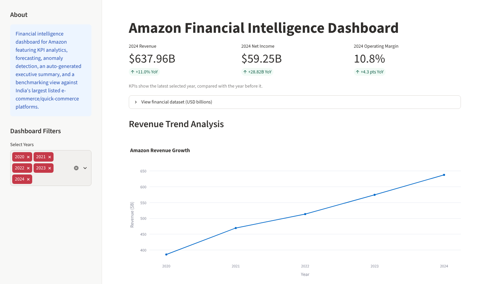
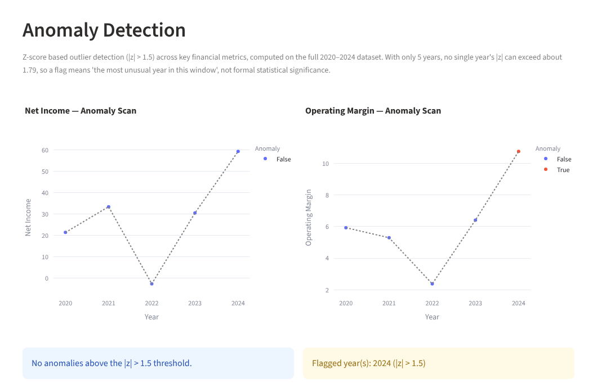
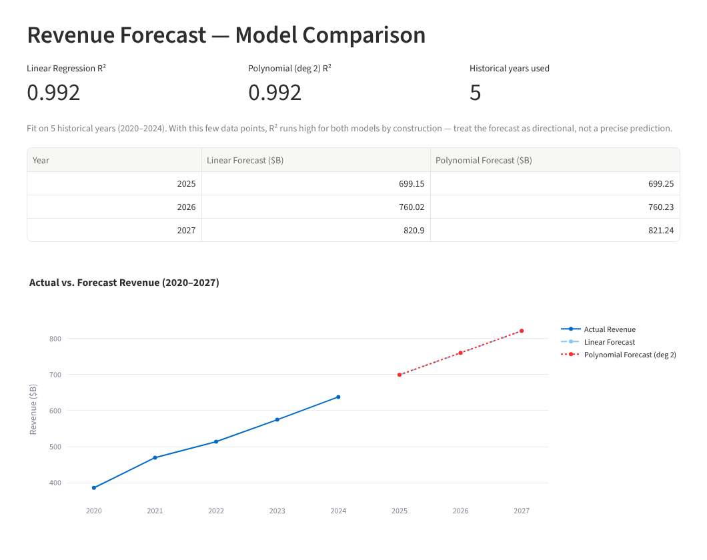
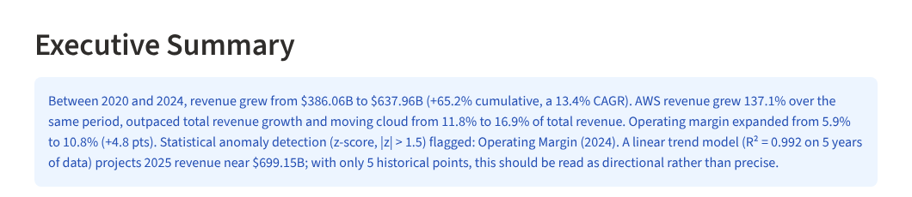
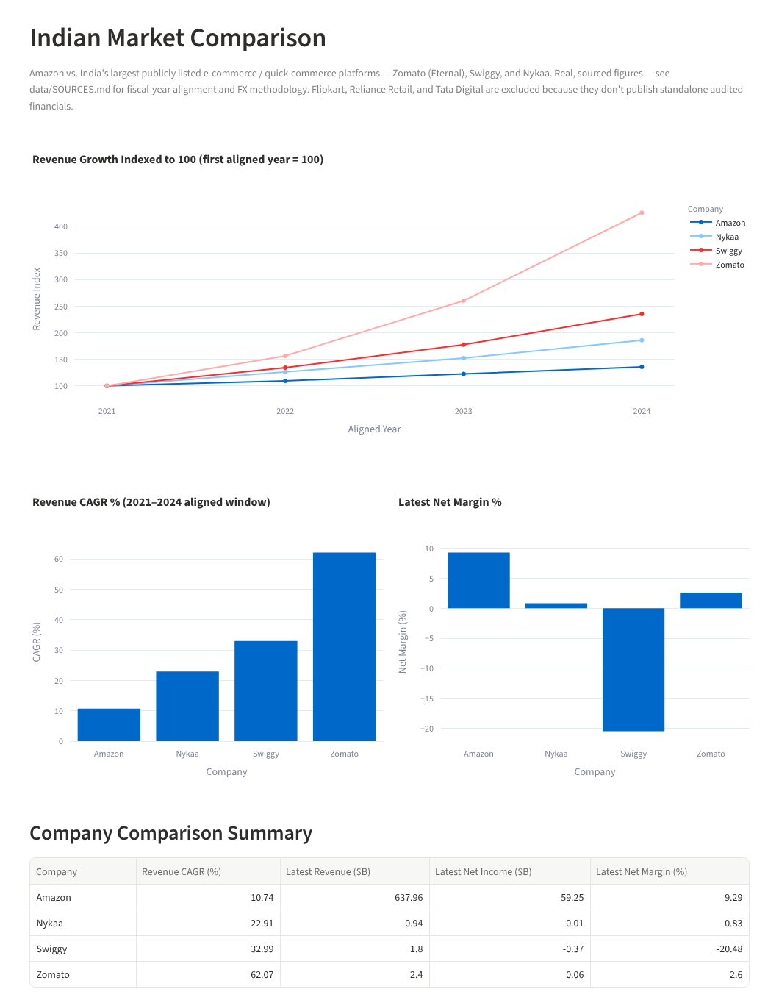

# Amazon Financial Intelligence Platform

An interactive financial analytics and forecasting platform built with Python, SQL, Streamlit, and Power BI. It analyzes Amazon's financial performance from 2020–2024 and benchmarks it against India's largest publicly listed digital-commerce platforms (Zomato, Swiggy, Nykaa).

The platform combines KPI monitoring, dual-model revenue forecasting, z-score anomaly detection, a rule-based executive summary generator, and cross-market benchmarking in one modular, deployable app. All figures come from audited public filings; see [`data/SOURCES.md`](data/SOURCES.md) for where each number comes from.



---

## Features

* Interactive Streamlit dashboard with year filtering
* KPI cards for the latest selected year (revenue, net income, operating margin) with year-over-year change
* Rule-based executive summary that turns the revenue trend, AWS growth, margin shift, anomalies, and forecast into one paragraph
* Revenue forecasting with **Linear vs. Polynomial regression**, reporting R² for each model
* Z-score anomaly detection (|z| > 1.5) on Net Income and Operating Margin, highlighted directly on the charts
* **Indian Market Comparison**: Amazon vs. Zomato (Eternal), Swiggy, and Nykaa on indexed growth, CAGR, net margin, and scale, using real, sourced financials
* SQL analytics layer (MySQL) that reproduces the core KPIs, the anomaly check, and the cross-market comparison with window functions
* Power BI report of Amazon's core KPIs (PDF export in [`Powerbi/`](Powerbi))
* Modular Python package (9 focused modules)

---

## Dashboard

### Anomaly Detection

Z-score outlier detection (|z| > 1.5) runs on the full 5-year dataset for Net Income and Operating Margin. Flagged years are highlighted in red with a callout. On the current data it flags Amazon's 2024 operating margin (z ≈ 1.53), the largest deviation in the window, which lines up with AWS and advertising driving an outsized share of profit that year.

With only 5 data points, no single year's |z| can exceed about 1.79, so a flag here means "most unusual year in this window", not formal statistical significance. Moving to quarterly data (see Future Enhancements) would make this test meaningfully stronger.



### Revenue Forecast: Model Comparison

Forecasts 2025–2027 revenue with two models fit side by side, a linear trend and a degree-2 polynomial, each reported with its R². Both fit the 5 historical years almost perfectly (R² ≈ 0.99), which is expected with so few points. The dashboard says so explicitly and treats the forecast as directional, not precise.



### Executive Summary

A template-driven generator ([`Python/insights.py`](Python/insights.py)) writes a single paragraph covering the selected period's revenue growth and CAGR, AWS growth vs. total revenue, the operating margin shift, any flagged anomalies, and the forecast. It is deterministic logic, not an external AI call.



### Indian Market Comparison

Benchmarks Amazon against Zomato, Swiggy, and Nykaa: the Indian digital-commerce companies that are publicly listed and publish audited financials. Flipkart, Reliance Retail, and Tata Digital are excluded because they don't publish standalone public financials, and the project doesn't fabricate figures for them.

India's April–March fiscal year is aligned to Amazon's calendar year, and all CAGRs are compared over the same 2021–2024 window.



---

## Tech Stack

| Category         | Technologies        |
| ---------------- | ------------------- |
| Programming      | Python              |
| Data Processing  | Pandas, NumPy       |
| Visualization    | Plotly, Matplotlib  |
| Dashboarding     | Streamlit, Power BI |
| Machine Learning | Scikit-learn        |
| Database         | SQL (MySQL)         |
| Version Control  | Git, GitHub         |

---

## Project Structure

```
├── data/
│   ├── Amazon_raw_data.xlsx
│   ├── indian_market_comparison.csv
│   └── SOURCES.md                 # provenance, FY alignment, FX method
│
├── Python/
│   ├── app.py                     # Streamlit dashboard
│   ├── main.py                    # standalone batch pipeline (matplotlib exports to outputs/charts/)
│   ├── preprocessing.py
│   ├── kpi_engine.py              # margin + CAGR
│   ├── forecasting.py             # linear + polynomial models, R²
│   ├── anomaly_detection.py       # z-score outlier detection
│   ├── insights.py                # rule-based executive summary generator
│   ├── indian_comparison.py       # Amazon vs. Indian peer benchmarking
│   └── visualization.py           # matplotlib static chart exports
│
├── Sql/
│   └── amazon_financial_analysis.sql   # schema, data, KPI, anomaly, and cross-market queries
│
├── Powerbi/                       # Power BI report (PDF export)
├── Indian Module/                 # scope notes for the Indian comparison
├── Screenshots/
├── requirements.txt
└── README.md
```

---

## Key Engineering Highlights

* Modular architecture with 9 separate layers (preprocessing, KPI engine, forecasting, anomaly detection, insight generation, cross-market comparison, visualization, app, batch pipeline)
* Preprocessing and forecasting logic shared between the Streamlit app and the standalone batch script
* Honest model reporting: two forecasting models compared side by side with R², plus an explicit small-sample caveat (n = 5) instead of an over-confident single number
* The same z-score anomaly check implemented in both Pandas and SQL (`STDDEV_SAMP` window aggregates); both return identical z-scores
* A second, independently sourced dataset (Indian public company filings) merged on a documented fiscal-year alignment key
* Data accuracy: the original dataset's FY2024 row held placeholder values; it was replaced with Amazon's actual reported FY2024 results from the Q4 2024 earnings release and cash-flow statement
* Deployed on Streamlit Community Cloud, with dependency and path fixes tracked in the commit history

---

## Running Locally

```bash
git clone https://github.com/shivaumsharma/Amazon-Financial-Analytics-Project.git
cd Amazon-Financial-Analytics-Project
pip install -r requirements.txt
```

Run the dashboard:

```bash
python -m streamlit run Python/app.py
```

Run the batch pipeline (prints KPIs, forecasts, anomalies, and the peer summary; saves static charts to `outputs/charts/`):

```bash
python Python/main.py
```

Run the SQL layer in MySQL 8+:

```bash
mysql -u <user> -p < Sql/amazon_financial_analysis.sql
```

---

## Future Enhancements

* Quarterly (not just annual) data, to give the anomaly detector and forecaster a larger sample
* Time-series forecasting (ARIMA / Prophet) that accounts for seasonality and autocorrelation
* Extend benchmarking to global peers (Walmart, Alibaba, JD.com)
* Bring the Power BI report up to date with the anomaly and Indian comparison views
* Live data refresh via a financial data API instead of a static extract

---

## Author

Shivaum Shekhar Sharma
B.Tech Computer Science & Engineering (Data Science), Manipal Institute of Technology, Bengaluru
