# Amazon Financial Intelligence Platform

An interactive financial analytics and forecasting platform built using Python, SQL, Streamlit, and Power BI to analyze Amazon's financial performance from 2020–2024, benchmarked against India's largest publicly listed digital commerce platforms.

The platform combines KPI monitoring, dual-model predictive analytics, statistical anomaly detection, a rule-based executive summary generator, and cross-market benchmarking into a modular and deployable analytics system. All figures are sourced from audited public filings — see [`data/SOURCES.md`](data/SOURCES.md) for full provenance.

---

# Features

* Interactive Streamlit dashboard with dynamic year filtering
* Revenue and profitability KPI tracking
* Rule-based auto-generated executive summary (revenue trend, cloud growth, margin shift, anomalies, forecast — synthesized into one narrative)
* Revenue forecasting with **Linear vs. Polynomial regression comparison**, reporting R² for each model
* Statistical anomaly detection (z-score, |z| > 1.5) across Net Income and Operating Margin, visualized directly on the charts
* **Indian Market Comparison module** — Amazon benchmarked against Zomato (Eternal), Swiggy, and Nykaa using real, sourced financials (indexed growth, CAGR, net margin, scale multiple)
* Interactive Plotly visualizations throughout
* Operating margin analysis
* Cloud (AWS) revenue contribution analysis
* Modular analytics architecture (9 focused Python modules)
* SQL-driven financial preprocessing, including window-function anomaly detection and cross-market queries
* Power BI reporting integration

---

# Dashboard Capabilities

## KPI Monitoring

Track:

* Total Revenue
* Net Income
* Operating Income
* Operating Margin
* Year-over-Year Growth

## Anomaly Detection

Z-score outlier detection (|z| > 1.5) runs on the full 5-year dataset for Net Income and Operating Margin, with each metric's chart highlighting flagged years in red and a callout explaining the result. On the current dataset it correctly flags Amazon's 2024 operating margin (z ≈ 1.53) as a statistically significant expansion — consistent with AWS and advertising's outsized contribution to profit that year.

## Predictive Analytics

Forecasts 2025–2027 revenue using two models fit side-by-side — a linear trend and a degree-2 polynomial — each reported with its R² score, so the forecast comes with an explicit confidence signal rather than a single unqualified number.

## Executive Insights

A template-driven narrative generator (`Python/insights.py`) synthesizes the selected period's revenue growth and CAGR, AWS growth vs. total revenue, operating margin shift, any flagged anomalies, and the forecast trajectory into a single readable paragraph — deterministic logic, not an external AI call.

## Indian Market Comparison

Benchmarks Amazon against Zomato, Swiggy, and Nykaa — the three companies from the original roadmap that are publicly listed and disclose audited financials (Flipkart, Reliance Retail, and Tata Digital are excluded for lack of standalone public filings). Shows indexed revenue growth, CAGR, net margin, and Amazon's scale multiple over each company, aligning India's April–March fiscal year to Amazon's calendar year.

## Interactive Filtering

Users can dynamically filter dashboard visualizations by year using Streamlit sidebar controls.

---

# Tech Stack

| Category         | Technologies        |
| ---------------- | ------------------- |
| Programming      | Python              |
| Data Processing  | Pandas, NumPy       |
| Visualization    | Plotly, Matplotlib  |
| Dashboarding     | Streamlit, Power BI |
| Machine Learning | Scikit-learn        |
| Database         | SQL                 |
| Version Control  | Git, GitHub         |

---

# Project Structure

```bash
Amazon Financial Intelligence/
│
├── data/
│   ├── Amazon_raw_data.xlsx
│   ├── indian_market_comparison.csv
│   └── SOURCES.md
│
├── Python/
│   ├── app.py                 # Streamlit dashboard
│   ├── main.py                 # standalone batch pipeline (matplotlib exports)
│   ├── preprocessing.py
│   ├── kpi_engine.py            # margin + CAGR
│   ├── forecasting.py           # linear + polynomial models, R²
│   ├── anomaly_detection.py     # z-score outlier detection
│   ├── insights.py              # rule-based executive summary generator
│   ├── indian_comparison.py     # Amazon vs. Indian peer benchmarking
│   └── visualization.py         # matplotlib static chart exports
│
├── Sql/
│   └── amazon SQL prompts.sql
│
├── Powerbi/
│
├── Indian Module/
│
├── Screenshots/
│   └── dashboard/
│
├── requirements.txt
├── README.md
└── .gitignore
```

---

# Key Engineering Highlights

* Modular architecture with 9 separated analytics layers (preprocessing, KPI engine, forecasting, anomaly detection, insight generation, cross-market comparison, visualization, app, batch pipeline)
* Reusable preprocessing and forecasting pipelines shared between the Streamlit app and the standalone batch script
* Statistical rigor over a single black-box model: two forecasting models compared side-by-side with explicit R² reporting, and an explicit small-sample caveat (n=5) rather than an over-confident single-number forecast
* Anomaly detection implemented, wired into the live UI, and validated against a real, explainable business signal (2024 operating margin expansion)
* External data integration: a second, independently-sourced dataset (Indian public company filings) merged against the primary dataset on an explicit, documented fiscal-year-alignment key
* Every dataset ships with a sources/methodology note (`data/SOURCES.md`) — figures are traceable to filed financials, not placeholder numbers
* Production-style project organization with iterative Streamlit Cloud deployment (dependency + path resolution fixes tracked in commit history)
* End-to-end analytics workflow from raw data ingestion through anomaly detection, forecasting, narrative generation, and cross-market visualization

---

# Forecasting Model

The project fits two models on the same 5-year window and reports both:

* Linear Regression — primary forecast, R² ≈ 0.99 on 2020–2024 revenue
* Polynomial Regression (degree 2) — comparison model to check whether added complexity meaningfully improves fit

Both R² scores are surfaced in the dashboard alongside an explicit caution that, with only 5 historical points, results should be read as directional rather than precise — a deliberate choice to avoid overstating forecast confidence.

Future planned upgrades:

* ARIMA / Prophet / time-series-native forecasting (current models don't account for seasonality or autocorrelation)
* XGBoost forecasting
* Expand the peer-benchmarking set to global players (Walmart, Alibaba, JD.com) alongside the Indian comparison already built
* Real-time data refresh via a financial data API instead of a static extract

---

# Installation

Clone the repository:

```bash
git clone https://github.com/shivaumsharma/Amazon-Financial-Analytics-Project.git
```

Navigate into the project:

```bash
cd "Amazon Financial Intelligence"
```

Install dependencies:

```bash
pip install -r requirements.txt
```

Run the Streamlit application:

```bash
python -m streamlit run Python/app.py
```

---

# Dashboard Preview

> **Note:** the screenshots below are from an earlier version of the dashboard. They still reflect the core KPI, revenue, AWS, and margin views accurately, but predate the Anomaly Detection, Forecast Model Comparison, and Indian Market Comparison sections — retake screenshots of those sections before using this README as a portfolio reference.

## Main Dashboard

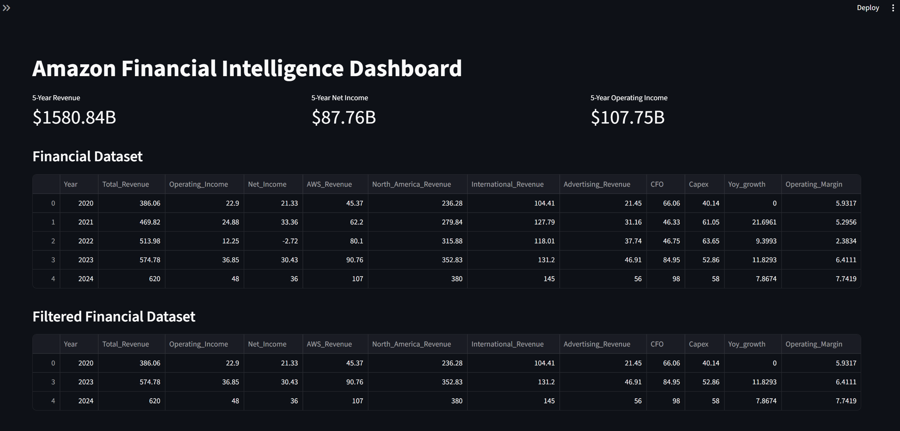

---

## KPI & Dataset Overview

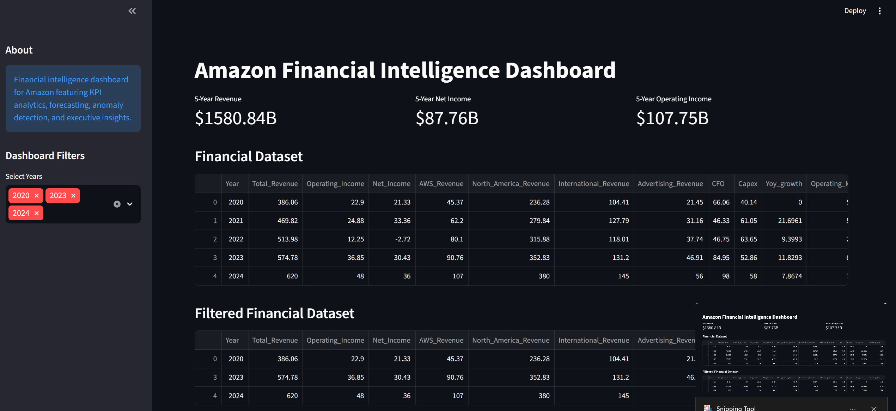

---

## Revenue Forecasting Dashboard

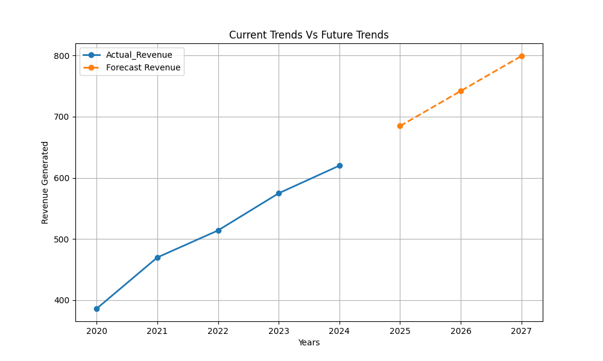

---

## Revenue Forecast Chart

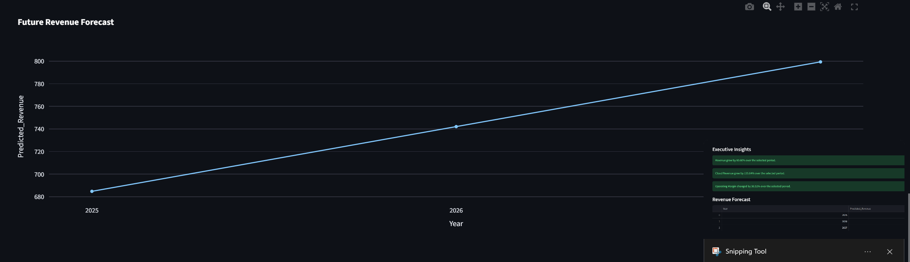

---

## Executive Insights

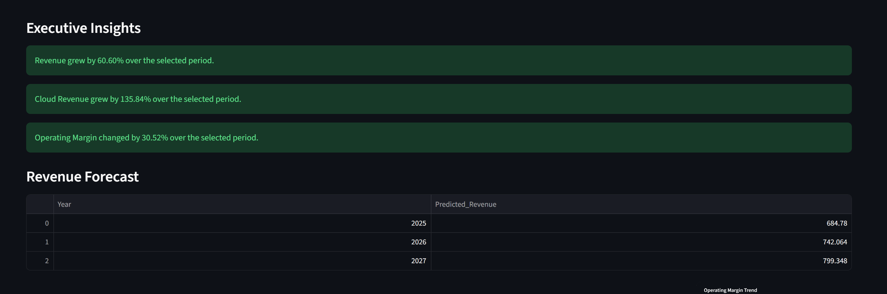

---

## AWS Contribution Analysis

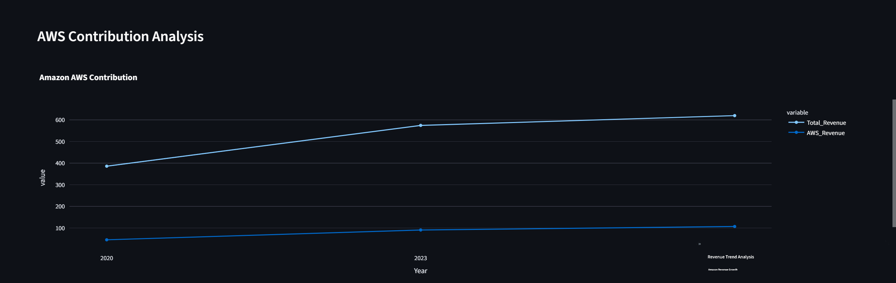

---

## AWS vs Revenue Trend

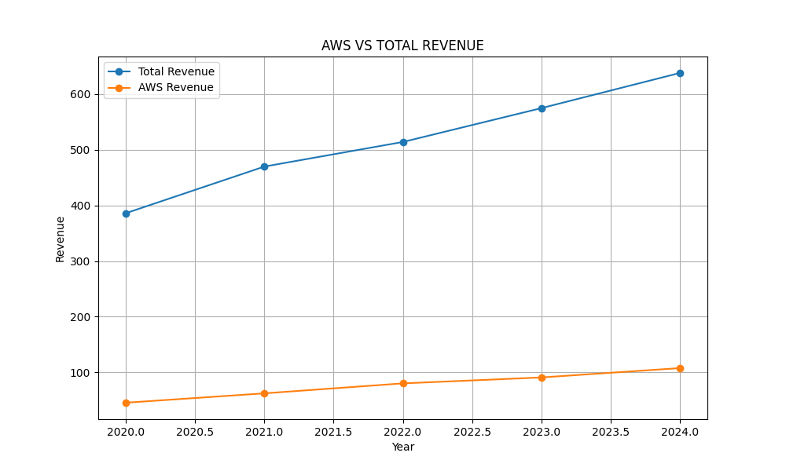

---

## Operating Margin Analysis

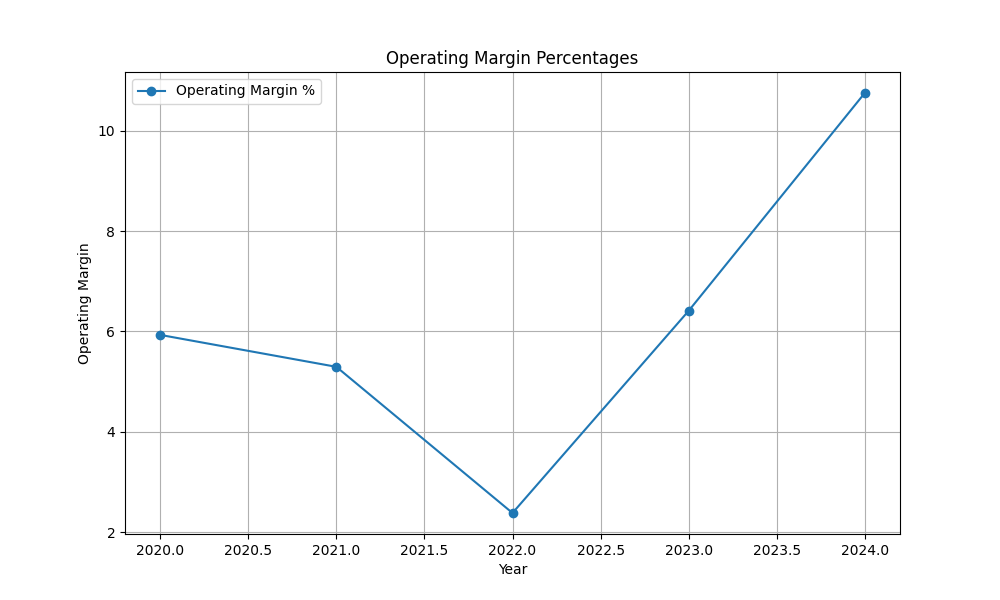

---

## Operating Margin Trend

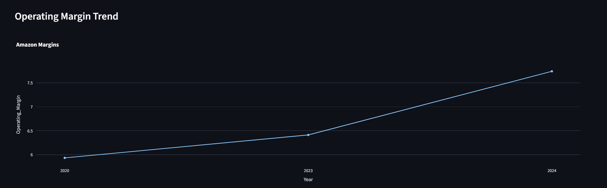

---

## Revenue Growth Analysis

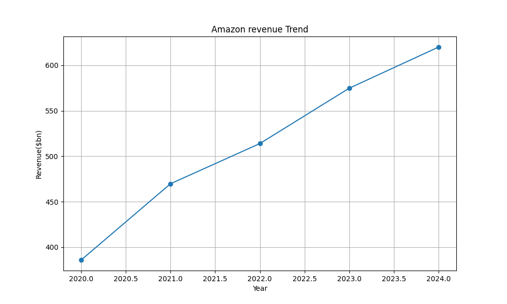

---

## YOY Growth Analysis

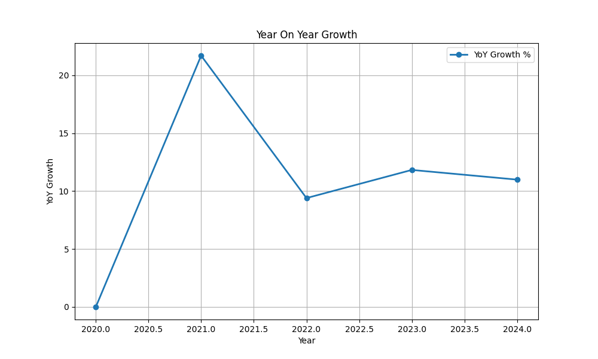

---

## Revenue Trend Visualization

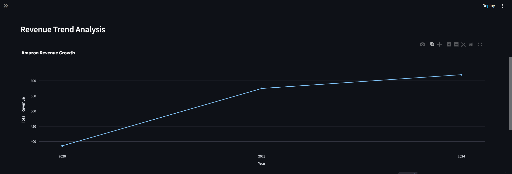

---

## Profitability Analysis

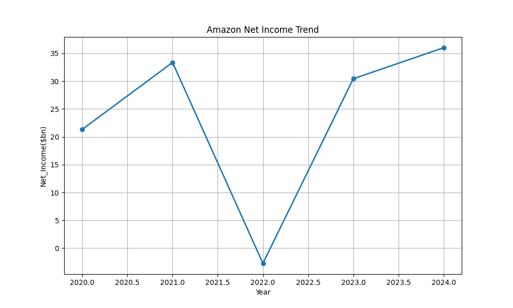

---

# Deployment

The application is deployment-ready using:

* Streamlit Community Cloud

Deployment architecture includes:

* Modular code structure
* Dependency management
* Reusable analytics pipelines
* Interactive dashboarding
* GitHub integration

---

# Future Enhancements

* Extend multi-company benchmarking beyond India to global peers (Walmart, Alibaba, JD.com)
* Time-series-native forecasting (ARIMA / Prophet / XGBoost) to replace the current regression-based approach
* Real-time data refresh via a financial data API instead of a static extract
* LLM-generated business summaries as an optional layer on top of the existing rule-based generator
* Quarterly (not just annual) granularity, to give the anomaly detector and forecaster a larger sample to work with

---

# Author

Shivaum Shekhar Sharma

Computer Science Engineering (Data Science)
Manipal Institute of Technology, Bengaluru

---
